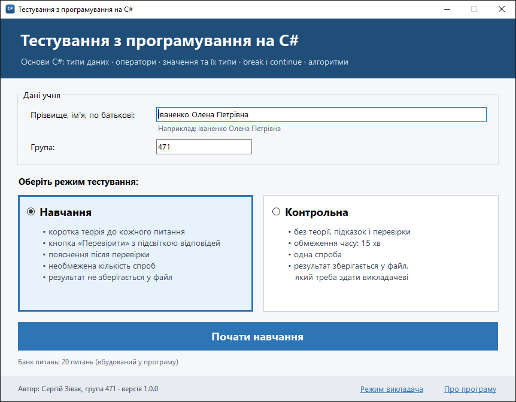
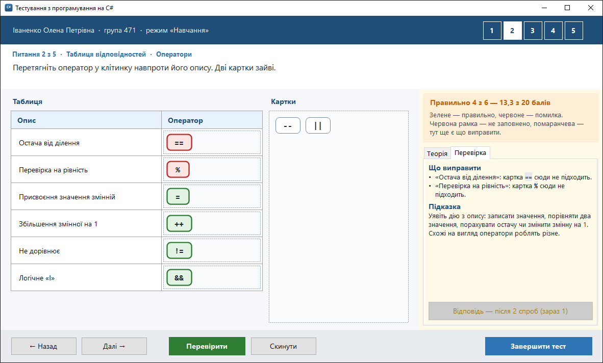
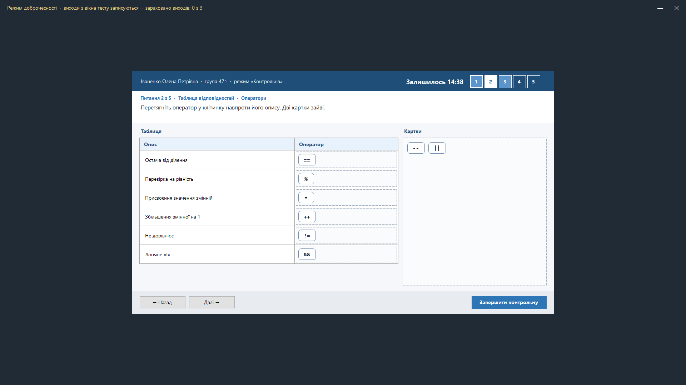

# Тестування з програмування на C#

Навчальна програма для Windows: тести з основ C# із завданнями на перетягування (Drag-and-Drop).
Учень проходить тест у режимі **«Навчання»** (з теорією і перевіркою) або **«Контрольна»** (з таймером і підписаним
файлом результату), а вчитель у режимі за паролем бачить таблицю результатів, перевіряє, чи файли не змінювали,
і експортує все в Excel.

Автор — Сергій Зівак, група 471. Додаткове завдання з дисципліни «Інструментальні засоби візуального програмування».

[](https://github.com/zivak0707-lang/Lab_Testing/releases/latest/download/Lab_Testing.exe)

<sub>**Для вчителя і для ознайомлення** · [усі випуски](https://github.com/zivak0707-lang/Lab_Testing/releases/latest) · ≈ 52 МБ ·
Windows 10/11 x64, встановлювати .NET не потрібно · синє вікно Windows під час першого запуску —
[як його пройти](#попередження-smartscreen)</sub><br>
<sub>Учні отримують програму від учителя — архівом разом із його банком питань (див. [«Для учня»](#для-учня)):
програма, завантажена звідси, працює з демонстраційним банком, і результати учнів учитель побачить як «⚠ Загальний ключ».</sub>



## Можливості

- **П'ять типів завдань на перетягування:** «Кошик», «Таблиця відповідностей», «Номерки на категорії»,
  «Слова в пропуски», «Порядок кроків». У тесті — по одному випадковому питанню кожного типу, картки перемішуються.
- **«Навчання»:** теорія до кожного питання, кнопка «Перевірити» з підсвіткою і підказкою (без готової відповіді),
  правильна відповідь — після кількох спроб.
- **«Контрольна»:** таймер, одна спроба, бали з частковими відповідями, оцінка за 12-бальною шкалою,
  файл результату з підписом (будь-яка зміна у файлі помітна вчителю).
- **Режим доброчесності:** правила перед стартом, контрольна на весь екран, запис виходів з вікна,
  дострокове завершення після ліміту виходів, захист від знімків екрана (вмикає вчитель).
- **Режим викладача:** таблиця результатів зі справжністю файлів, порушеннями і повторними спробами,
  подробиці з хронологією, експорт у Excel (`.xlsx`) або CSV, власний банк питань і ключ підпису.
- Один файл `Lab_Testing.exe` — встановлювати .NET не потрібно. Інтерфейс українською.

| Питання в «Навчанні» | Контрольна на весь екран |
|---|---|
|  |  |

## Для учня

1. Отримайте від учителя архів **`Lab_Testing_для_учнів.zip`**, розпакуйте його в будь-яку теку
   (`Lab_Testing.exe` і `questions.dat` мають лежати поруч) і запустіть `Lab_Testing.exe`.
2. Якщо Windows показує синє вікно — див. [нижче](#попередження-smartscreen).
3. Введіть прізвище, ім'я та по батькові (кирилицею) і групу, виберіть режим.
4. Після контрольної файл результату з'явиться на робочому столі в теці **«Результати тесту C#»** —
   надішліть його вчителю (Classroom, Telegram тощо).

### Попередження SmartScreen

Програма не має платного цифрового підпису, тому під час першого запуску Windows може показати синє вікно:
- українська Windows: **«Windows захистила ваш ПК»** → **«Докладніше»** → **«Виконати в будь-якому разі»**;
- російська Windows: **«Система Windows защитила ваш компьютер»** → **«Подробнее»** → **«Выполнить в любом случае»**;
- англійська Windows: **«Windows protected your PC»** → **«More info»** → **«Run anyway»**.

## Для вчителя

**Швидкий старт:** [завантажте `Lab_Testing.exe`](https://github.com/zivak0707-lang/Lab_Testing/releases/latest/download/Lab_Testing.exe)
(останній випуск, ≈ 52 МБ) → «Режим викладача» → підготуйте власний банк питань → «Підготувати банк для учнів» →
**роздайте учням створений ZIP** (а не посилання на завантаження: без вашого `questions.dat` учні пройдуть
демонстраційний банк, а їхні файли буде позначено «⚠ Загальний ключ»).

Пароль викладача можна отримати в автора; після першого входу змініть його.


Докладно — у **[посібнику вчителя](docs/TEACHER_GUIDE.md)**: формат банку з прикладами всіх п'яти типів і шаблоном,
ключ підпису, режим доброчесності (якщо під час контрольної ви спілкуєтеся з учнями в Zoom/Meet — ставте
`"exitLimit": 0`), повторні спроби, журнал і сценарій передачі банку.

## Відомі обмеження

- **Підпис файлу** захищає від редагування в Блокноті, але не від програміста: програма відкрита, загальний ключ
  і ключ шифрування `questions.dat` є в коді, тож ключ учителя теоретично можна дістати з `questions.dat`.
- **Вбудований банк — демонстраційний**, його відповіді є в цьому репозиторії. Для контрольної готуйте власний.
- **Режим доброчесності** не захищає від телефона, другого пристрою, людини поруч, підказок на другому моніторі
  (лише позначка «моніторів: 2»), віртуальної машини і фото екрана. Він ускладнює списування і дає вчителю повну картину.
- **Повторні спроби** вчитель бачить лише серед файлів, які відкрив; інше написання прізвища чи чуже ПІБ не розпізнати.
- **Журнал** `log.txt` лежить на комп'ютері учня — це підказка для розбору, а не доказ. Доказ — підписаний файл.
- Якщо процес примусово закрили (Диспетчер задач) або вимкнулося живлення, файл результату не збережеться.
- Програма лише для Windows 10/11 (x64).

## Збірка з вихідного коду

Потрібні Visual Studio 2026 (або .NET SDK 10) з робочим навантаженням «Розробка класичних застосунків .NET».

- Відкрити `Lab_Testing.slnx` і запустити (F5). Усі форми відкриваються в конструкторі VS.
- Один exe для поширення: `powershell -ExecutionPolicy Bypass -File publish.ps1` → тека `publish\`.

```
Lab_Testing/
  Forms/        вікна (StartForm, TestForm, ResultForm, TeacherForm, BankToolsForm, IntegrityForm …)
  DragDrop/     картка-джерело і зона-приймач (стандартний Drag-and-Drop .NET)
  Questions/    п'ять типів завдань
  Model/        банк питань, сесія, бали й оцінка, режим доброчесності, правила для ПІБ
  Services/     файл результату з підписом, ключ учителя, банк для учнів, Excel/CSV, журнал, обробка збоїв
  Data/         демонстраційний банк (20 питань) і шаблон банку
tools/ScreenshotMaker/   утиліта знімків і самоперевірок (не входить у програму)
docs/           посібник учителя, список питань і теорії
```

## Ліцензія

[MIT](LICENSE) © 2026 Сергій Зівак. Сторонні бібліотеки та їхні ліцензії — у [THIRD-PARTY-NOTICES.md](THIRD-PARTY-NOTICES.md).
