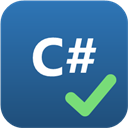
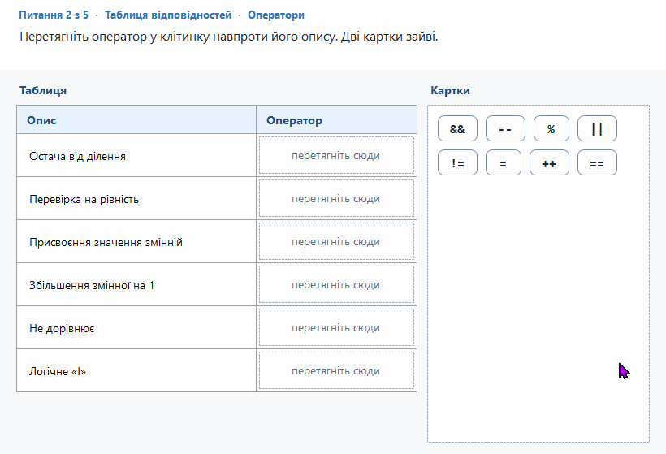
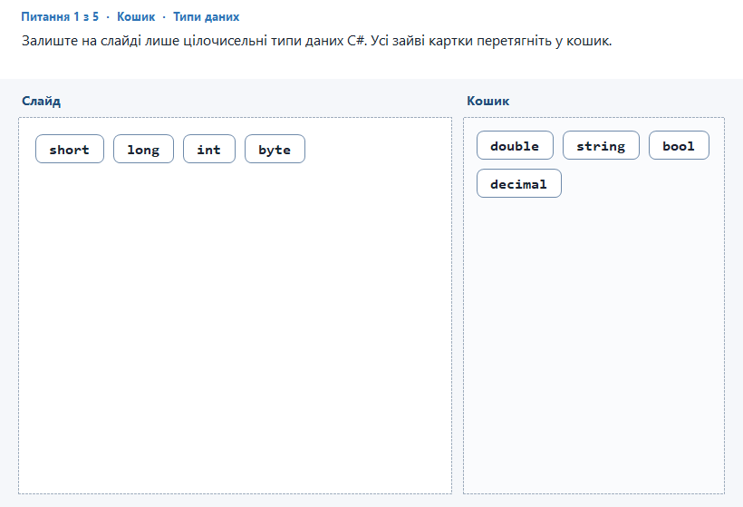
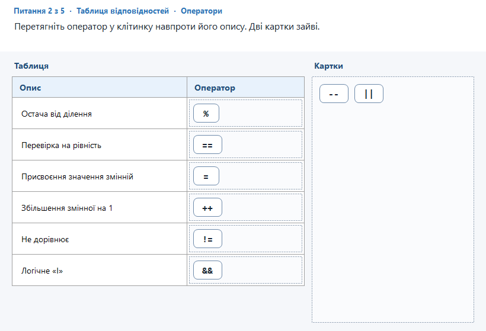
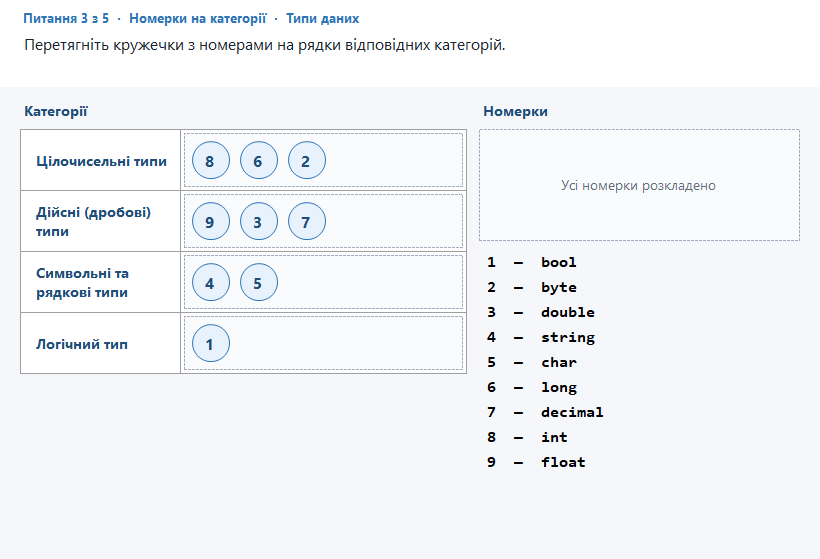
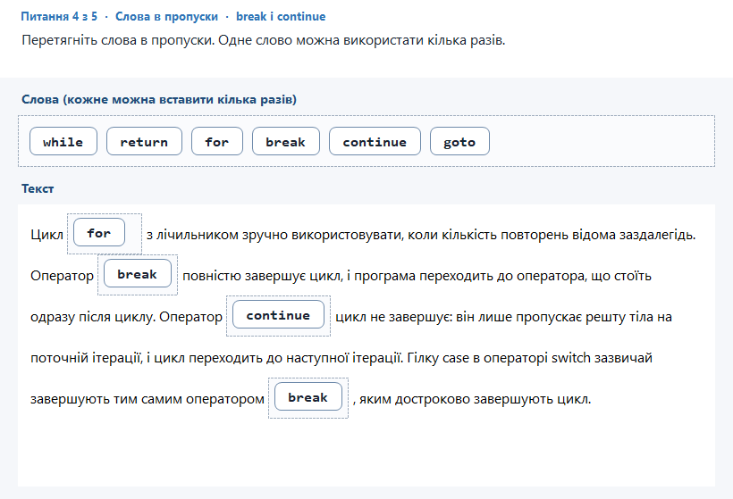
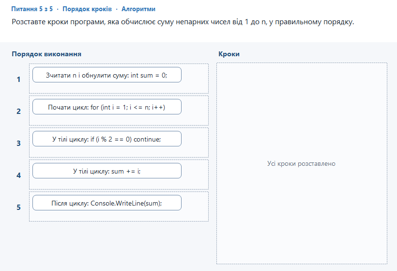
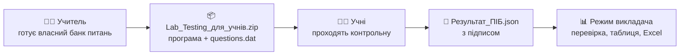
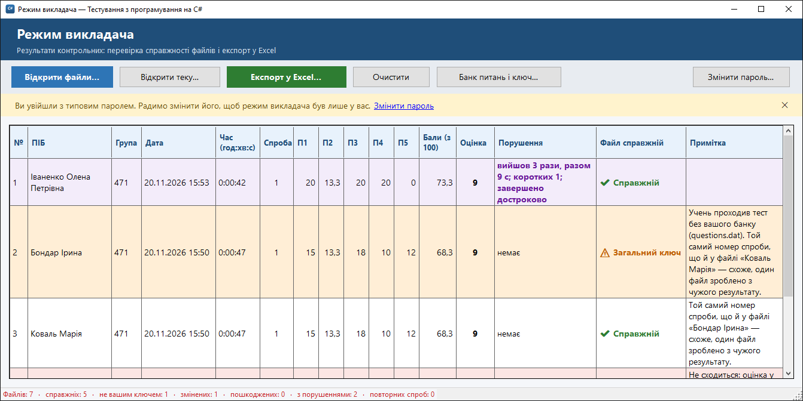

<div align="center">



# Тестування з програмування на C#

**Тести з основ C# із завданнями на перетягування — для уроків, домашніх завдань і контрольних.**<br>
Учень розкладає картки мишею, програма сама рахує бали й оцінку, а вчитель отримує підписані файли результатів
і таблицю в Excel.

[](https://github.com/zivak0707-lang/Lab_Testing/releases/latest)
[](https://github.com/zivak0707-lang/Lab_Testing/releases)
[](#для-учня)
[](#для-розробника)
[](#можливості)
[](LICENSE)

[](https://github.com/zivak0707-lang/Lab_Testing/releases/latest/download/Lab_Testing.exe)

<sub>**Для вчителя і для ознайомлення** · [усі випуски](https://github.com/zivak0707-lang/Lab_Testing/releases/latest) · ≈ 52 МБ ·
Windows 10/11 x64, встановлювати .NET не потрібно · синє вікно Windows під час першого запуску —
[як його пройти](#попередження-smartscreen)</sub><br>
<sub>Учні отримують програму від учителя — архівом разом із його банком питань (див. [«Для учня»](#для-учня)).</sub>



<sub>Справжнє перетягування мишею: оператор переміщується в клітинку таблиці (Move),
а слово <code>break</code> копіюється одразу в два пропуски (Copy).</sub>

</div>

---

## Можливості

| | |
|---|---|
| 🧩 **П'ять типів завдань на перетягування** | «Кошик», «Таблиця відповідностей», «Номерки на категорії», «Слова в пропуски», «Порядок кроків». У тесті — по одному випадковому питанню кожного типу, картки перемішуються |
| 📚 **«Навчання»** | теорія до кожного питання, кнопка «Перевірити» з підсвіткою і підказкою — без готової відповіді; правильну відповідь можна відкрити після двох спроб |
| ⏱️ **«Контрольна»** | таймер, одна спроба, часткові бали, оцінка за 12-бальною шкалою, файл результату з підписом: якщо змінити в ньому хоч символ, учитель це побачить |
| 🛡️ **Режим доброчесності** | правила перед стартом, контрольна на весь екран, запис кожного виходу з вікна, дострокове завершення після ліміту, захист від знімків екрана |
| 👩‍🏫 **Режим викладача** | таблиця результатів: справжність файлів, порушення, повторні спроби; подробиці з хронологією; експорт у Excel |
| 📦 **Один файл** | `Lab_Testing.exe` — без встановлення і без .NET, працює без інтернету, інтерфейс повністю українською |

## П'ять типів завдань

| 🧺 Кошик — лишити потрібне, зайве в кошик | 🔗 Таблиця відповідностей — картку навпроти опису |
|:---:|:---:|
|  |  |
| **🔢 Номерки на категорії — кружечки на рядки** | **✍️ Слова в пропуски — одне слово можна вставити кілька разів** |
|  |  |
| **🪜 Порядок кроків — розставити кроки алгоритму** | |
|  | |

## Як це працює



| | 📚 Навчання | ⏱️ Контрольна |
|---|:---:|:---:|
| Теорія до кожного питання | ✅ | — |
| «Перевірити» з підсвіткою і підказкою | ✅ | — |
| Таймер | — | ✅ 15 хв (змінюється в банку) |
| Спроби | без обмежень | одна |
| Бали й оцінка за 12-бальною шкалою | ✅ | ✅ |
| Файл результату з підписом | — | ✅ |
| Режим доброчесності | — | ✅ |

| Перевірка в «Навчанні» | Контрольна на весь екран |
|:---:|:---:|
|  |  |

## Для учня

1. Отримайте від учителя архів **`Lab_Testing_для_учнів.zip`** і розпакуйте його в будь-яку теку
   (`Lab_Testing.exe` і `questions.dat` мають лежати поруч).
2. Запустіть `Lab_Testing.exe`. Якщо Windows показує синє вікно — див. [нижче](#попередження-smartscreen).
3. Введіть прізвище, ім'я та по батькові (кирилицею) і групу, виберіть режим.
4. Після контрольної файл результату з'явиться на робочому столі в теці **«Результати тесту C#»** —
   надішліть його вчителю (Classroom, Telegram тощо).

### Попередження SmartScreen

Програма не має платного цифрового підпису, тому під час першого запуску Windows може показати синє вікно:

| Мова Windows | Що натиснути |
|---|---|
| українська | **«Windows захистила ваш ПК»** → **«Докладніше»** → **«Виконати в будь-якому разі»** |
| російська | **«Система Windows защитила ваш компьютер»** → **«Подробнее»** → **«Выполнить в любом случае»** |
| англійська | **«Windows protected your PC»** → **«More info»** → **«Run anyway»** |

## Для вчителя

1. [**Завантажте `Lab_Testing.exe`**](https://github.com/zivak0707-lang/Lab_Testing/releases/latest/download/Lab_Testing.exe)
   (останній випуск, ≈ 52 МБ) і запустіть.
2. **«Режим викладача»** → пароль. Пароль викладача можна отримати в автора; після першого входу змініть його.
3. **«Банк питань і ключ…»** → складіть власний банк питань (є шаблон) → **«Підготувати банк для учнів»**.
4. **Роздайте учням створений ZIP**, а не посилання на завантаження: без вашого `questions.dat` учні пройдуть
   демонстраційний банк, а їхні файли буде позначено «⚠ Загальний ключ».
5. Відкрийте файли учнів у режимі викладача (кнопкою або перетягніть з Провідника) і експортуйте таблицю в Excel.



> [!TIP]
> Якщо під час контрольної ви спілкуєтеся з учнями в Zoom/Meet, поставте в банку `"exitLimit": 0`:
> виходи з вікна тесту лише записуватимуться, а контрольна не завершиться достроково, коли учень перейде відповісти вам.

📖 Усе докладно — у **[посібнику вчителя](docs/TEACHER_GUIDE.md)**: формат банку з прикладами всіх п'яти типів
і шаблоном, ключ підпису, режим доброчесності, повторні спроби, журнал і сценарій передачі банку.

## Часті запитання

<details>
<summary><b>У таблиці файл учня позначено «⚠ Загальний ключ». Що не так?</b></summary>

Учень проходив тест без вашого `questions.dat` — найчастіше завантажив програму звідси, а не отримав ваш ZIP.
Такий файл підписано загальним ключем програми, тож його справжність гарантувати не можна.
</details>

<details>
<summary><b>Учень змінив оцінку у файлі результату. Я це побачу?</b></summary>

Так: файл буде позначено «✗ Змінено!», а в «Примітці» програма напише, що саме не сходиться
(наприклад, «оцінка у файлі 12, а за балами — 9»).
</details>

<details>
<summary><b>Учень виходив з вікна під час контрольної?</b></summary>

Кожен вихід записано: коли, на скільки секунд і на якому питанні. Це видно в стовпці «Порушення»,
у подробицях з хронологією і на аркуші «Події» в Excel.
</details>

<details>
<summary><b>Учень пройшов контрольну двічі на різних комп'ютерах?</b></summary>

Повторні спроби програма шукає серед відкритих вами файлів за ПІБ і групою (латинські двійники літер, апострофи
і регістр не заважають), а лічильник на комп'ютері учня, якщо він інший, показує в «Примітці».
</details>

<details>
<summary><b>Чи потрібен інтернет?</b></summary>

Ні. Програма працює повністю офлайн; файл результату учень надсилає вам будь-яким зручним способом.
</details>

<details>
<summary><b>Де лежить файл результату, якщо учень його не знайшов?</b></summary>

На робочому столі в теці «Результати тесту C#»; копія — у `%AppData%\Lab_Testing\results`.
</details>

## Відомі обмеження

- **Підпис файлу** захищає від редагування в Блокноті, але не від програміста: програма відкрита, загальний ключ
  і ключ шифрування `questions.dat` є в коді, тож ключ учителя теоретично можна дістати з `questions.dat`.
- **Вбудований банк — демонстраційний**, його відповіді є в цьому репозиторії. Для контрольної готуйте власний.
- **Режим доброчесності** не захищає від телефона, другого пристрою, людини поруч, підказок на другому моніторі
  (лише позначка «моніторів: 2»), віртуальної машини і фото екрана. Він ускладнює списування і дає вчителю повну картину.
- **Повторні спроби** вчитель бачить лише серед файлів, які відкрив; інше написання прізвища чи чуже ПІБ не розпізнати.
- **Журнал** `log.txt` лежить на комп'ютері учня — це підказка для розбору, а не доказ. Доказ — підписаний файл.
- Якщо процес примусово закрили (Диспетчер задач) або вимкнулося живлення, файл результату не збережеться.
- Програма лише для Windows 10/11 (x64).

## Для розробника

Visual Studio 2026 (або .NET SDK 10) з навантаженням «Розробка класичних застосунків .NET»:
відкрийте `Lab_Testing.slnx` і запустіть (F5) — усі форми відкриваються в конструкторі VS.
Один exe для поширення: `powershell -ExecutionPolicy Bypass -File publish.ps1` → тека `publish\`.

Drag-and-Drop — стандартний механізм .NET: картка викликає `DoDragDrop`, зони з `AllowDrop = true` обробляють
`DragEnter`, `DragOver`, `DragLeave` і `DragDrop`; ефект `Move` переносить картку, `Copy` — копіює слово в пропуск.

<details>
<summary><b>Структура проєкту</b></summary>

```
Lab_Testing/
  Forms/        вікна (StartForm, TestForm, ResultForm, TeacherForm, BankToolsForm, IntegrityForm …)
  DragDrop/     картка-джерело і зона-приймач (стандартний Drag-and-Drop .NET)
  Questions/    п'ять типів завдань
  Model/        банк питань, сесія, бали й оцінка, режим доброчесності, правила для ПІБ
  Services/     файл результату з підписом, ключ учителя, банк для учнів, Excel/CSV, журнал, обробка збоїв
  Data/         демонстраційний банк (20 питань) і шаблон банку
tools/ScreenshotMaker/   утиліта знімків і самоперевірок (не входить у програму)
docs/           посібник учителя, список питань і теорії, картинки README
```
</details>

---

<div align="center">

[MIT](LICENSE) © 2026 Сергій Зівак, група 471 · Додаткове завдання з дисципліни
«Інструментальні засоби візуального програмування» · Сторонні бібліотеки — у [THIRD-PARTY-NOTICES.md](THIRD-PARTY-NOTICES.md)

</div>
